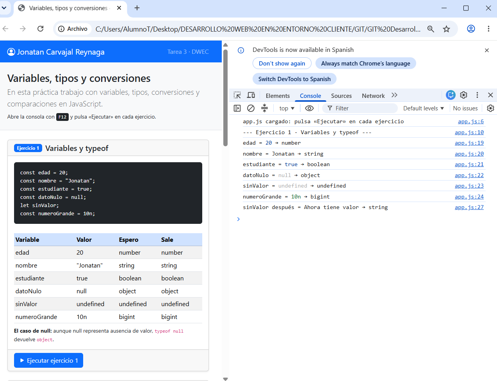
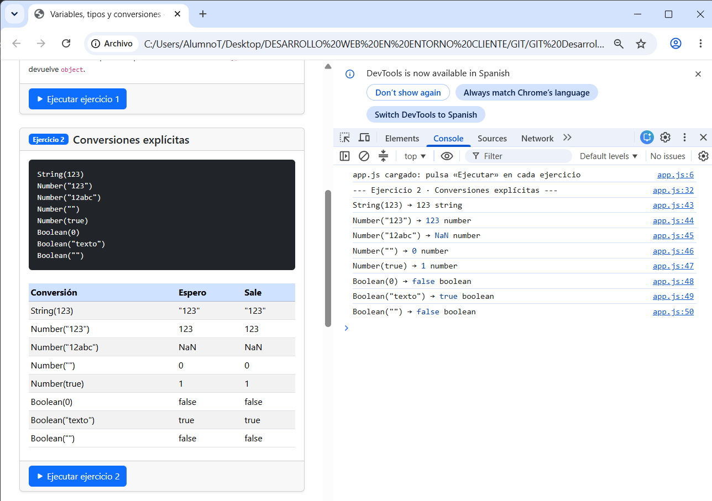
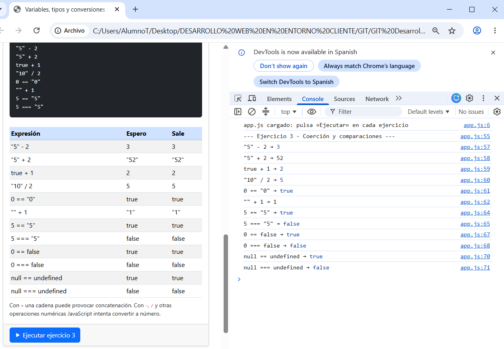
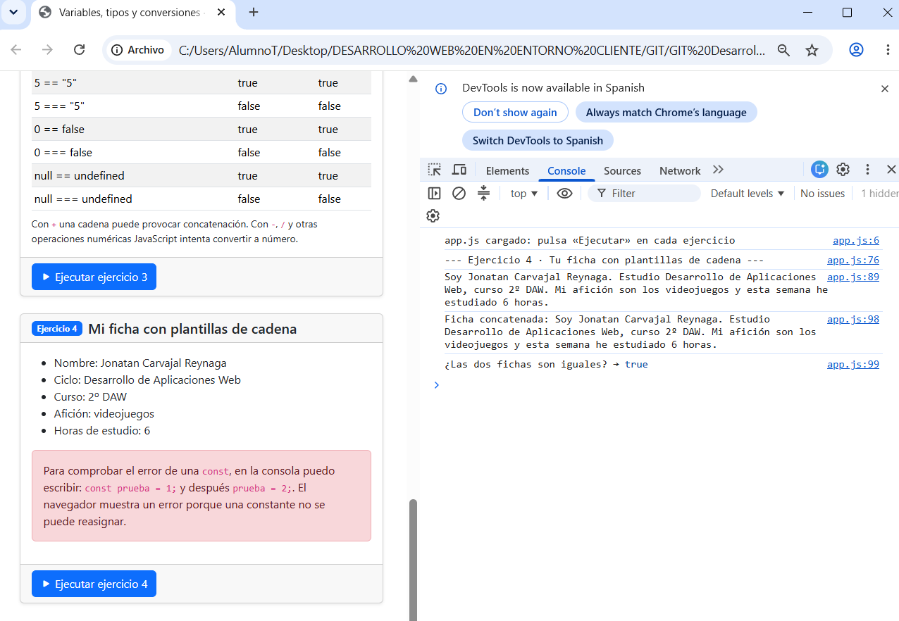

# Tarea 3 · Variables, tipos y conversiones

**Autor:** Jonatan Carvajal Reynaga · Desarrollo Web en Entorno Cliente (DWEC) · 2.º DAW · Curso 2026-27

En esta carpeta está la práctica del Tema 3. Para probarla abro `index.html` con Live Server, abro la consola con F12 y pulso el botón «Ejecutar» de cada ejercicio.

## Capturas

### a) La página entera

Se ve la página completa con mi nombre en la barra superior y las cuatro tarjetas de los ejercicios.

### b) Consola del ejercicio 1

Se ven las variables creadas en el ejercicio 1 junto con el valor y el resultado de `typeof`.

### c) Consola del ejercicio 2

Se ven los resultados de las conversiones con `String()`, `Number()` y `Boolean()`.

### d) Consola del ejercicio 3

Se ven ejemplos de coerción de tipos y las diferencias entre `==` y `===`.

### e) Consola del ejercicio 4, con el error de la const

Se ve mi ficha en la consola y el error que aparece al intentar cambiar el valor de una constante.

## Reflexión

Las conversiones que me han resultado más fáciles son `String(123)` y `Number("123")` porque el resultado es bastante directo. También entendí bien que `Boolean(0)` devuelve `false` y que una cadena con texto devuelve `true`. Lo que más me llamó la atención fue que `Number("")` devuelve `0`. En las comparaciones también se nota bastante la diferencia entre `==` y `===`. Por ejemplo, `5 == "5"` devuelve `true`, pero `5 === "5"` devuelve `false` porque con `===` también se compara el tipo. También me resultó curioso que `typeof null` devuelva `object`.

## Fuentes

- Apuntes y plantilla del Tema 3 de Desarrollo Web en Entorno Cliente.
- MDN Web Docs: https://developer.mozilla.org/es/docs/Web/JavaScript
- JavaScript.info: https://javascript.info/type-conversions

## Uso de IA

He utilizado ChatGPT como ayuda para organizar la práctica, revisar el código y entender algunos resultados de las conversiones y comparaciones. Después he revisado el contenido, he ejecutado los ejercicios personalmente y he realizado mis propias capturas esto incluido esta creado con la IA 
