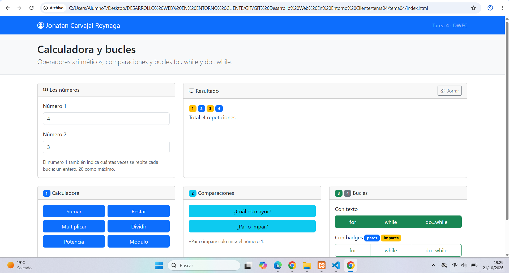
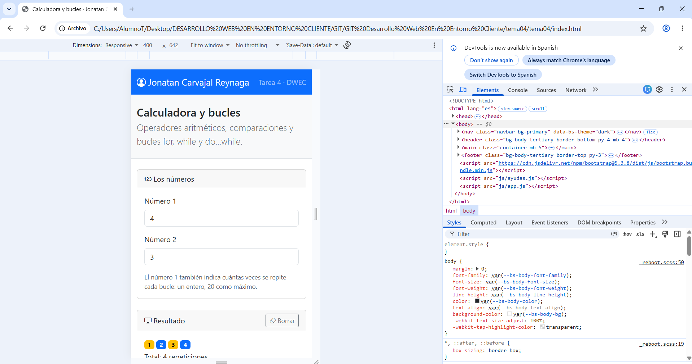
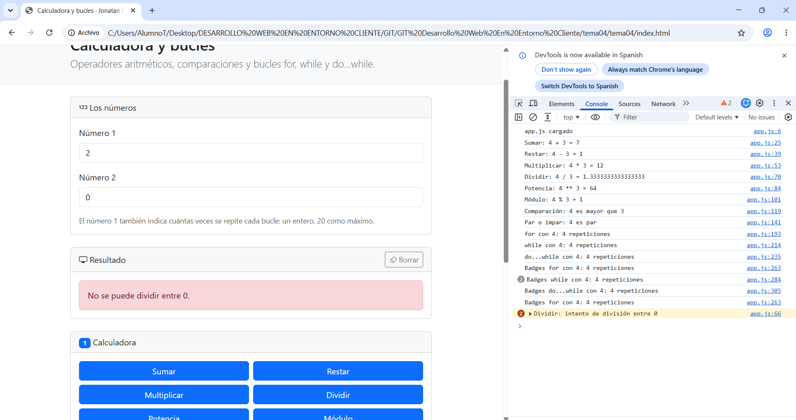
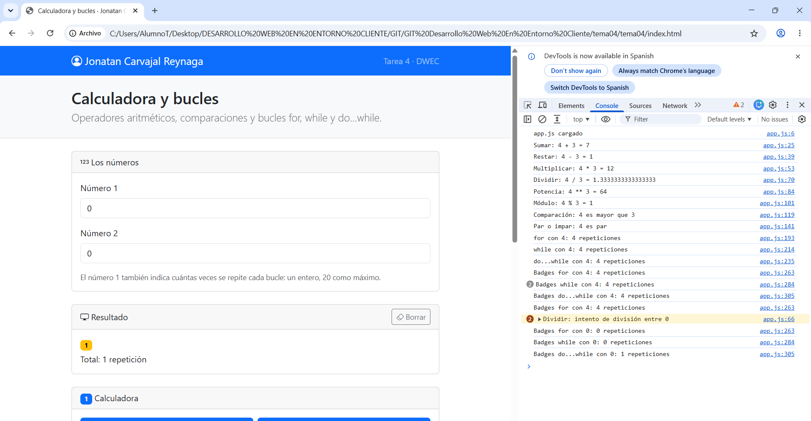
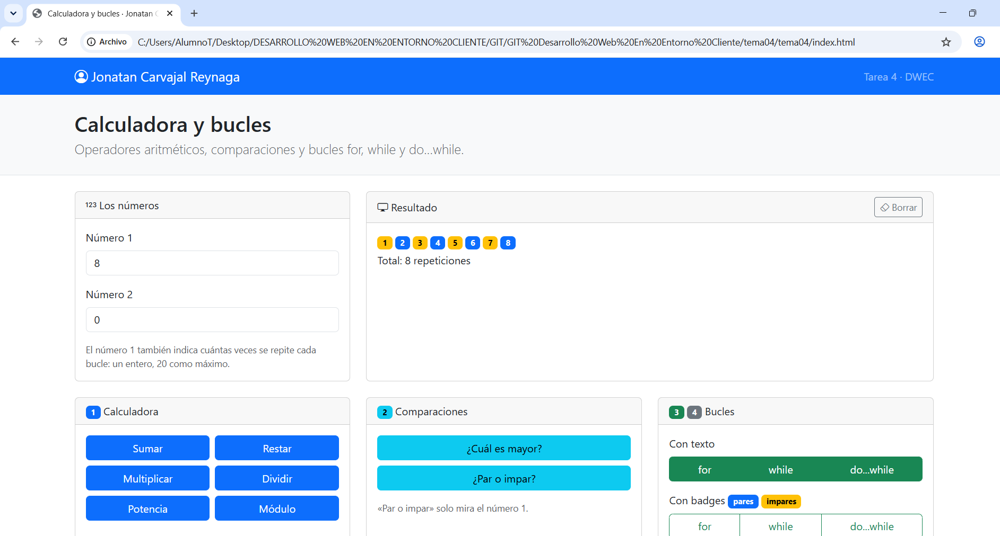

# Tarea 4  Calculadora y bucles

**Autor:** Jonatan Carvajal Reynaga · Desarrollo Web en Entorno Cliente (DWEC) · 2.º DAW · Curso 2026-27

En esta carpeta está la práctica del Tema 4. La página se abre con Live Server desde VS Code. Se escriben dos números en las casillas y se prueban las operaciones, las comparaciones y los bucles. Para comprobar el funcionamiento también abro la consola con F12, ya que cada función deja un mensaje.

## Capturas

### a) La página entera

Se ve mi nombre en la navbar y las cards repartidas con la rejilla de Bootstrap: números, resultado, calculadora, comparaciones y bucles.

### b) La página en el móvil

En modo móvil las cards aparecen una debajo de otra para adaptarse al ancho de la pantalla.

### c) El error de dividir entre 0

Se ve el número 2 con valor 0, el aviso rojo que impide la división y el mensaje que deja la función en la consola.

### d) Los tres bucles con el número 0

Con 0, `for` y `while` hacen 0 repeticiones porque comprueban la condición antes de entrar. `do...while` hace 1 repetición porque comprueba la condición después de ejecutar el bloque.

### e) Un bucle con badges

He usado el número 8 como ejemplo. Cada vuelta crea un badge y el color se elige con un operador ternario: los pares salen en azul y los impares en amarillo.

## Reflexión 

`for`, `while` y `do...while` sirven para repetir código, pero no funcionan exactamente igual. `for` es cómodo cuando sé cuántas veces quiero repetir porque incluye el contador en la propia estructura. `while` comprueba la condición antes de ejecutar el bloque, así que puede no entrar ninguna vez. `do...while` comprueba la condición después y por eso siempre ejecuta el bloque al menos una vez. Esto se ve al probar los tres con 0: `for` y `while` hacen 0 repeticiones, pero `do...while` hace 1. Usaría `for` cuando conozco el número de repeticiones, `while` cuando dependo de una condición y `do...while` cuando necesito ejecutar el bloque al menos una vez.

## Fuentes
- IA CHATGPT
- Apuntes del Tema 4 de Desarrollo Web en Entorno Cliente.
- [MDN Web Docs - JavaScript](https://developer.mozilla.org/es/docs/Web/JavaScript)
- [Bootstrap](https://getbootstrap.com/)

## Uso de IA

He utilizado la IA CHAT GPT como apoyo para organizar la práctica y crear este readme, revisar el código y comprobar los requisitos del enunciado. Después he revisado el contenido, he probado personalmente todos los botones, he comprobado los resultados con la consola  
