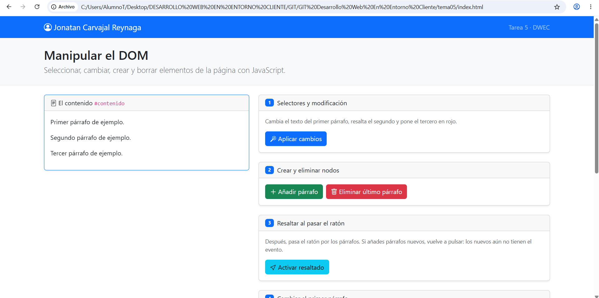
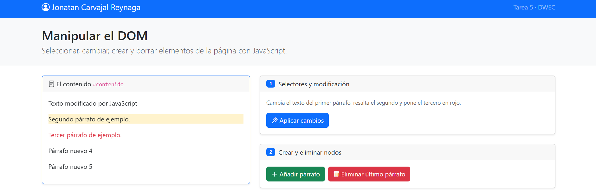
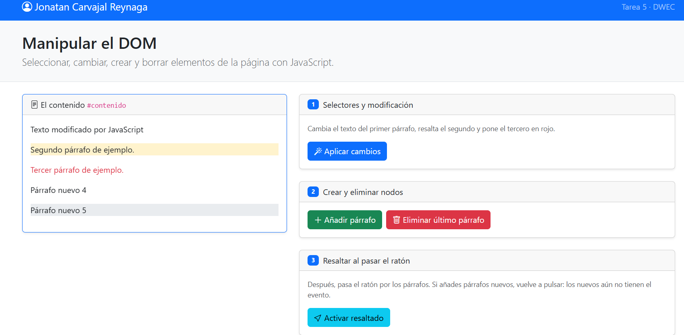
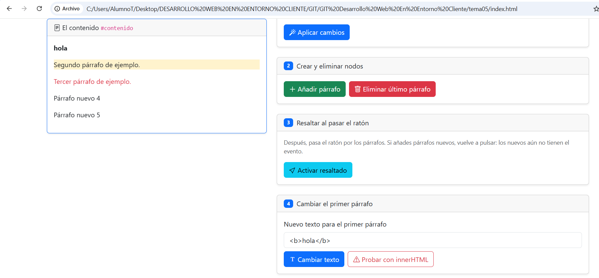
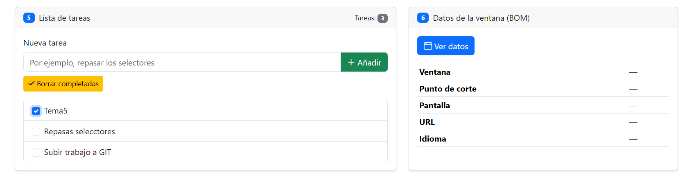
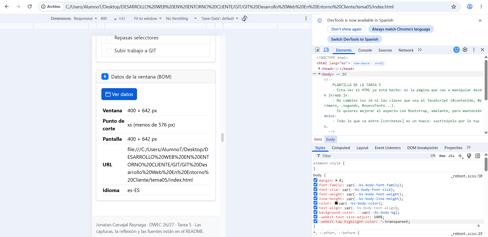

# Tarea 5 · Manipular el DOM

**Autor:** Jonatan Carvajal Reynaga · Desarrollo Web en Entorno Cliente (DWEC) · 2.º DAW · Curso 2026-27

En esta carpeta está la práctica del Tema 5. La página se abre con Live Server desde VS Code y permite probar seis ejercicios de manipulación del DOM y del BOM. Para comprobar el funcionamiento también se puede abrir la consola con F12, ya que cada función deja un mensaje.

## Capturas

### a) La página recién cargada

Se ve la página inicial con mi nombre en la navbar y los tres párrafos de partida dentro de `#contenido`.

### b) Ejercicios 1 y 2

El primero cambia con `getElementById`, el segundo se selecciona con `querySelector` y el tercero con `querySelectorAll`. También se añaden nuevos párrafos con `createElement` y `append`.

### c) Ejercicio 3: resaltado al pasar el ratón

Al pasar el ratón por un párrafo se añade la clase `bg-body-secondary`. Los párrafos añadidos después no tienen los eventos hasta volver a pulsar «Activar resaltado».

### d) Ejercicio 4: `<b>hola</b>` con innerHTML

Con `textContent`, `<b>hola</b>` se muestra como texto. Con `innerHTML`, el navegador interpreta la etiqueta y muestra **hola** en negrita.

### e) Ejercicio 5: la lista de tareas

Se muestran tres tareas, cada una con su casilla, y una de ellas marcada antes de pulsar «Borrar completadas».

### f) Ejercicio 6: los datos de la ventana en el móvil

En modo móvil el punto de corte depende del ancho de la ventana. En el ordenador aparece un punto de corte mayor según el ancho disponible.

## Reflexión

`textContent` trata todo lo que recibe como texto, mientras que `innerHTML` interpreta el contenido como código HTML. Al escribir `<b>hola</b>` con `textContent`, se ven literalmente las etiquetas. En cambio, con `innerHTML`, el navegador crea una etiqueta `<b>` y muestra la palabra en negrita. Por eso no se debe introducir directamente en `innerHTML` lo que escribe un usuario: podría insertar etiquetas o código no deseado. Para mostrar texto escrito por el usuario es más seguro usar `textContent`. En esta práctica se usan ambos para comprobar visualmente la diferencia.

## Fuentes

- Apuntes del Tema 5 de Desarrollo Web en Entorno Cliente.
- [MDN Web Docs - DOM](https://developer.mozilla.org/es/docs/Web/API/Document_Object_Model)
- [Bootstrap](https://getbootstrap.com/)

## Uso de IA

He utilizado ChatGPT como apoyo para organizar la práctica, revisar los requisitos y comprobar el código. Después he revisado el contenido, he probado personalmente los botones y he realizado mis propias capturas en mi equipo esto tambien fue generado con la IA 
