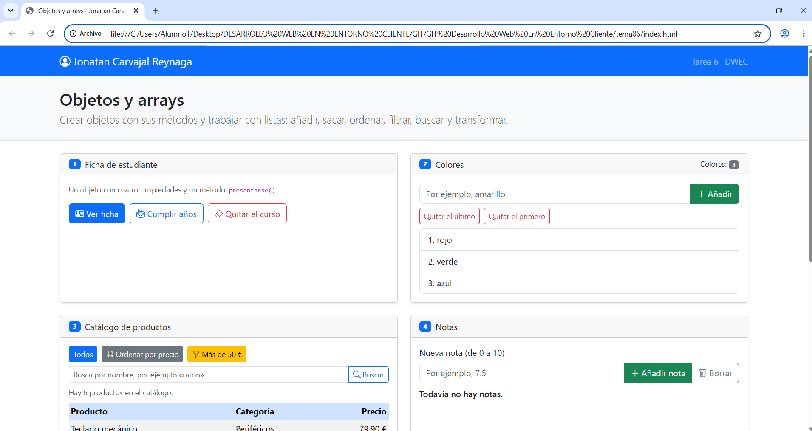
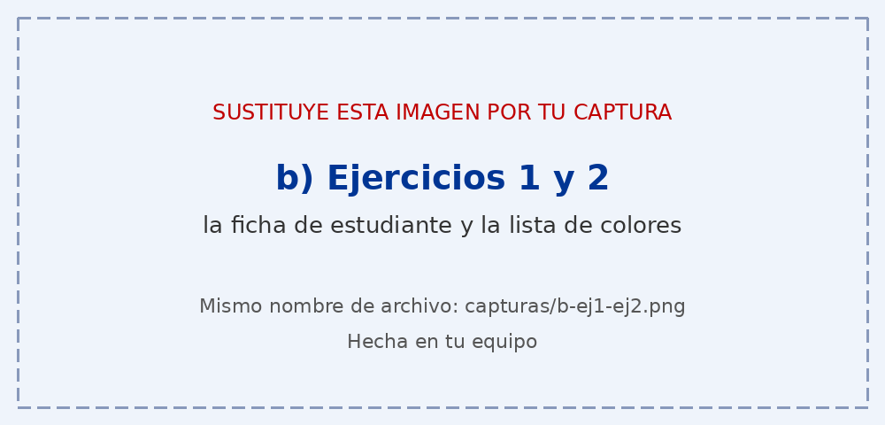
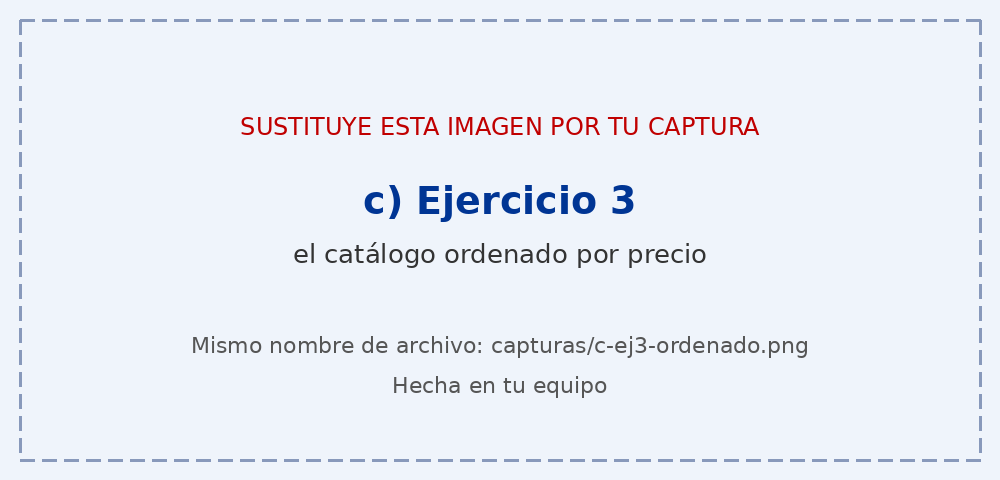
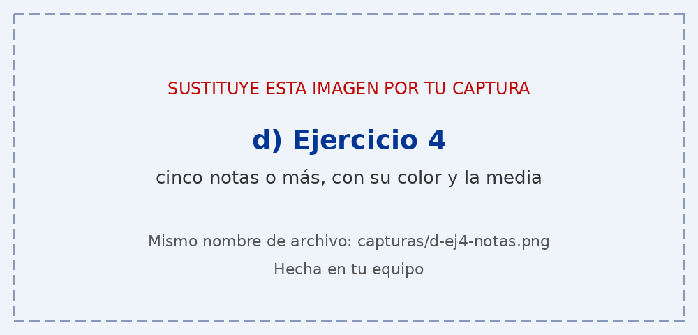
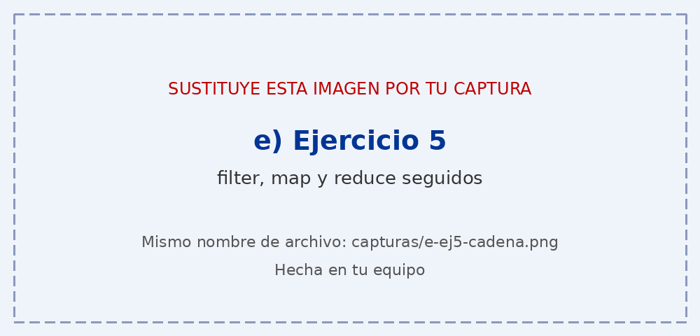
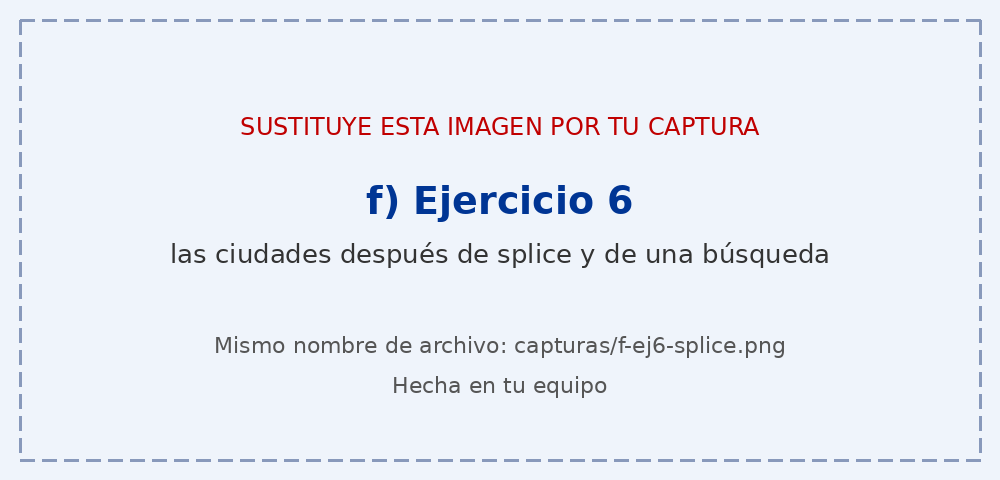

# Tarea 6 · Objetos y arrays

**Autor:** Jonatan Carvajal Reynaga · Desarrollo Web en Entorno Cliente (DWEC) · 2.º DAW · Curso 2026-27

En esta carpeta está la práctica del Tema 6. La página se abre con Live Server desde VS Code y permite probar seis ejercicios sobre objetos y arrays. Para comprobar el funcionamiento también uso la consola con F12, ya que las funciones dejan mensajes de seguimiento.

## Capturas

### a) La página recién cargada

Se ve mi nombre en la navbar, los tres colores iniciales, el catálogo completo y las ciudades con su posición.

### b) Ejercicios 1 y 2: la ficha y los colores

La ficha se actualiza al cumplir años y al borrar el curso aparece `undefined` porque esa propiedad ya no existe. En colores uso `push`, `pop` y `shift`.

### c) Ejercicio 3: el catálogo ordenado por precio

La comparación devuelve `a.precio - b.precio`. Ordeno una copia con `[...productos]` porque `sort()` modifica el array sobre el que se aplica y quiero conservar el catálogo original.

### d) Ejercicio 4: las notas y la media

Se muestran al menos cinco notas como badges: verdes las aprobadas y rojas las suspensas. La media se calcula con `reduce()` y se muestra con dos decimales.

### e) Ejercicio 5: los tres métodos seguidos

Primero `filter()` obtiene `[2, 4, 6, 8, 10]`, después `map()` crea `[4, 8, 12, 16, 20]` y finalmente `reduce()` suma esos valores. El resultado final es 60.

### f) Ejercicio 6: después de splice y de buscar una ciudad

`splice(2, 2)` elimina Málaga y Córdoba y modifica el array. Después se puede buscar una ciudad con `includes()` e `indexOf()` para comprobar si sigue y en qué posición está.

## Reflexión

Algunos métodos usados cambian el array original y otros crean un resultado nuevo. `push()`, `pop()`, `shift()`, `splice()` y `sort()` modifican directamente el array sobre el que se utilizan. En cambio, `slice()`, `map()` y `filter()` devuelven un array nuevo sin cambiar el original. En el ejercicio 6 se ve claramente: `slice(2, 5)` solo devuelve una parte y las ocho ciudades siguen estando, mientras que `splice(2, 2)` elimina dos ciudades. Por ese mismo motivo, en el ejercicio 3 hago una copia con `[...productos]` antes de usar `sort()`. Así puedo mostrar los productos ordenados sin alterar el catálogo original.

## Fuentes

- Apuntes del Tema 6 de Desarrollo Web en Entorno Cliente.
- [MDN Web Docs - Array](https://developer.mozilla.org/es/docs/Web/JavaScript/Reference/Global_Objects/Array)
- [Bootstrap](https://getbootstrap.com/)

## Uso de IA

He utilizado ChatGPT como apoyo para organizar la práctica, revisar los requisitos y comprobar el código. Después he revisado cada ejercicio, he probado personalmente los botones y la consola, y he realizado mis propias capturas en mi equipo esto incluido lo hice con la IA para ahorrar tiempo pero comprobando todo
