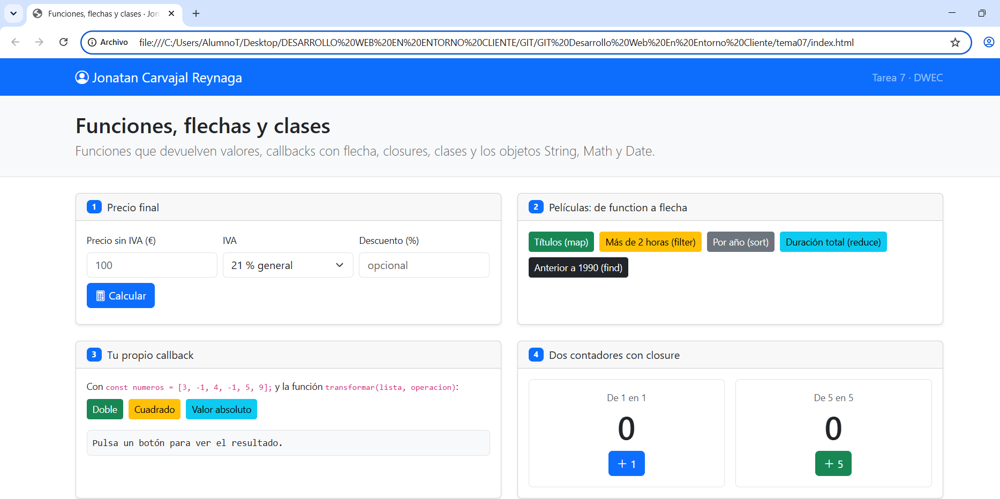
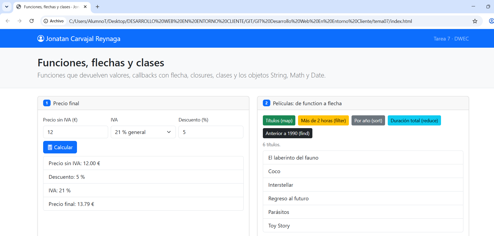
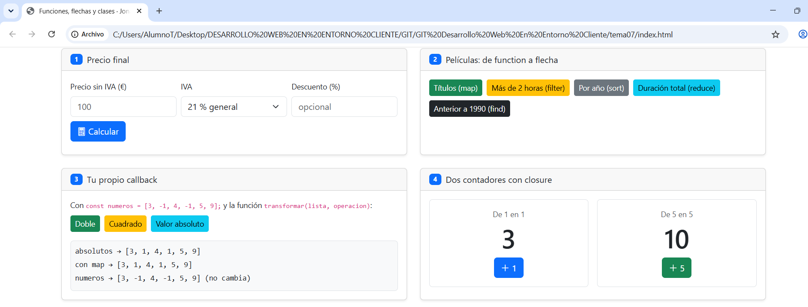
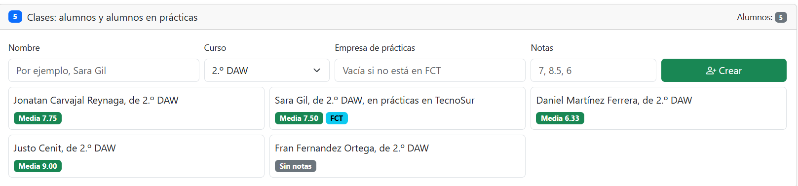
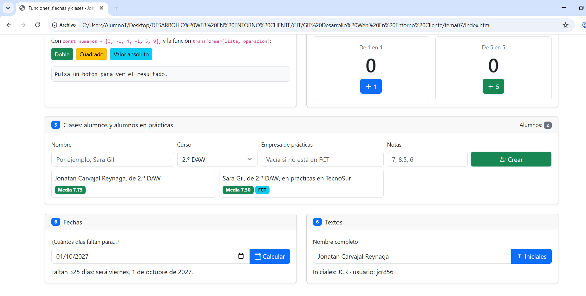

# Tarea 7 · Funciones, flechas y clases

**Autor:** Jonatan Carvajal Reynaga · Desarrollo Web en Entorno Cliente (DWEC) · 2.º DAW · Curso 2026-27

En esta carpeta está la práctica del Tema 7. La página se abre con Live Server desde VS Code y permite probar funciones, callbacks con flecha, closures, clases, fechas y textos. Para comprobar el funcionamiento también se puede abrir la consola con F12, ya que cada función deja un mensaje.

## Capturas

### a) La página recién cargada

Se ve la página recién cargada, mi nombre en la navbar y los dos alumnos creados al iniciar la aplicación.

### b) Ejercicios 1 y 2: el precio y las películas

`calcularPrecio()` devuelve el precio final aplicando primero el descuento y después el IVA. `mostrarPrecio()` lee los datos de la página, valida la entrada y pinta el desglose del resultado.

### c) Ejercicios 3 y 4: tu callback y los contadores

`transformar()` recorre la lista, aplica el callback recibido a cada elemento y guarda los resultados en un array nuevo. Cada contador conserva su propia variable `cuenta` gracias al closure creado por `crearContador()`.

### d) Ejercicio 5: los alumnos

El código crea un `Alumno` cuando la empresa está vacía y un `AlumnoFCT` cuando se indica una empresa de prácticas. Las tarjetas muestran la presentación y la media de cada alumno.

### e) Ejercicio 6: fechas y textos

En esta captura se prueba una fecha y un nombre completo. Los días se redondean con `Math.round()` porque los cambios horarios pueden hacer que la diferencia entre fechas no sea un número entero exacto de días.

## Reflexión

Al pasar un callback de `function` a flecha, el código queda más corto y directo. Si la flecha tiene una sola expresión, se puede omitir `return` y también las llaves. Si el cuerpo tiene varias instrucciones, sí hacen falta las llaves y un `return` cuando queremos devolver un valor. En esta práctica se usan flechas en callbacks como `map`, `filter`, `sort` y `reduce`. En cambio, los métodos de las clases se escriben con la sintaxis normal de método y no con flecha. Por ejemplo, `media()` pertenece a `Alumno`, mientras que el `reduce` que suma las notas utiliza una flecha.

## Fuentes

- Apuntes del Tema 7 de Desarrollo Web en Entorno Cliente.
- [MDN Web Docs - Funciones](https://developer.mozilla.org/es/docs/Web/JavaScript/Guide/Functions)
- [MDN Web Docs - Clases](https://developer.mozilla.org/es/docs/Web/JavaScript/Reference/Classes)

## Uso de IA

He utilizado ChatGPT como apoyo para organizar la práctica, revisar los requisitos y comprobar el código. Después he revisado el contenido, he probado personalmente los botones y he realizado mis propias capturas en mi equipo esto incluido fue generado con IA
